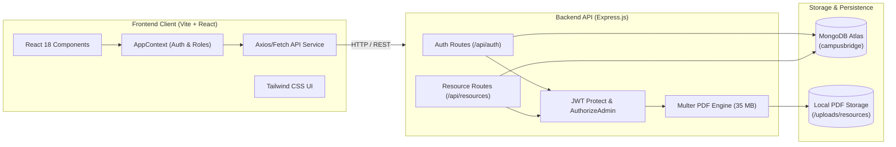

# Campus Bridge AI 🎓⚙️
### AI-Powered Academic & Skill Development Platform
**Department of Artificial Intelligence & Machine Learning (AIML)**  
**Canara Engineering College (Autonomous), Benjanapadavu, Mangaluru**

---

[](https://react.dev/)
[](https://vitejs.dev/)
[](https://tailwindcss.com/)
[](https://nodejs.org/)
[](https://expressjs.com/)
[](https://www.mongodb.com/atlas)
[](#-academic-curriculum-context)

---

## 📖 Table of Contents
- [Project Overview](#-project-overview)
- [Problem Statement](#-problem-statement)
- [Objectives](#-objectives)
- [Academic Curriculum Context](#-academic-curriculum-context)
- [Key Features](#-key-features)
- [Technology Stack](#️-technology-stack)
- [Project Folder Structure](#-project-folder-structure)
- [Environment Variables Setup](#-environment-variables-setup)
- [Installation & Local Setup](#-installation--local-setup)
- [Creating & Seeding an Administrator](#-creating--seeding-an-administrator)
- [Testing & Quality Assurance](#-testing--quality-assurance)
- [Future Enhancements](#-future-enhancements)
- [License](#-license)

---

## 🌟 Project Overview

**Campus Bridge AI** is a modern, student-centric academic web application designed specifically for undergraduate engineers and faculty in the **Department of Artificial Intelligence & Machine Learning (AIML)** at **Canara Engineering College (Autonomous)**.

Built with a unified purple & lavender visual language, the platform combines secure role-based student authentication, an administrative resource management system for publishing curriculum notes and question banks, an autonomous SGPA/CGPA grading calculator, and an interactive AI skill development tracker.

---

## ❗ Problem Statement

As colleges transition to autonomous governance, students and faculty face several critical challenges:

1. **Curriculum Information Gaps**: Transitioning to an autonomous system deprecates older university syllabus structures, creating confusion regarding active course codes, modules, teaching hours, and examination formats.
2. **Scattered Course Materials**: Official lecture notes, question banks, and laboratory specifications are often distributed through informal messaging channels, resulting in broken links, unverified materials, and version mismatch.
3. **Lack of Governance & Tampering Risks**: Public repositories without strict role-based access controls risk unauthorized modifications or uploading of unverified materials.
4. **Grading & Academic Analytics Misalignment**: Standard grading tools do not always adhere to the specific grading matrices, credit weightages, and SGPA formulas mandated under the autonomous scheme.
5. **Skill Readiness Gaps**: Students require structured, semester-aligned roadmaps to build fundamental machine learning, deep learning, and engineering competencies alongside regular coursework.

---

## 🎯 Objectives

- **Unified Academic Repository**: Establish an authoritative single source of truth for Canara Engineering College Autonomous AIML curriculum materials (Syllabus, Handouts, Question Banks, and Lab Specifications).
- **Role-Based Governance**: Enforce strict separation of privileges where only verified administrators and faculty can upload, modify, or delete official academic PDFs, while students enjoy instant preview and download access.
- **Autonomous Grading Precision**: Provide a dedicated SGPA/CGPA calculator calibrated strictly to the autonomous academic scheme and credit allocations.
- **Skill Progression Tracking**: Offer self-diagnostic technical evaluations and curated 4-week growth sprints to support student academic excellence.
- **High-Performance Architecture**: Deliver sub-second document streaming, responsive search, and secure JWT-based session management across desktop and mobile devices.

---

## 🏛️ Academic Curriculum Context

> [!IMPORTANT]
> **Canara Engineering College is an Autonomous Institution.**  
> Academic resources, course codes, modules, and grading schemes in Campus Bridge AI strictly reflect the **Canara Engineering College Autonomous Curriculum** (2024+ Autonomous Scheme), **NOT generic VTU schemes**.

### Department of AIML — 5th Semester Course Suite
The academic repository currently features verified, full-text autonomous study materials for 3rd Year AIML (Semester 5):

* **`BCS501` — Software Engineering & Project Management** (Core Theory, 3 Credits)
* **`BCS502` — Computer Networks** (Core Theory, 4 Credits)
* **`BAI515E` — Exploratory Data Analysis** (Professional Elective, 3 Credits)
* **`BRMK557` — Research Methodology & Intellectual Property Rights** (Core Theory, 3 Credits)

---

## 🚀 Key Features

### 1. 🔐 Secure Authentication & Role-Based Access Control (RBAC)
- **Student Sign-Up & Login**: Strict USN and college email validation with bcrypt-hashed password storage.
- **Role Isolation**: Public registration strictly forces `role: "student"`. Administrator privileges can never be granted via client payloads.
- **JWT Protection**: Stateful token verification on all protected endpoints with automatic session restoration and role normalization.
- **Visual Admin Badges**: Amber administrator badge displayed across Navbar and Sidebar for authenticated faculty/admin sessions.

### 2. 📂 Admin Resource Management System
- **PDF Document Uploads**: Authorized admins can upload autonomous academic PDFs (up to 35 MB) with metadata (Subject Name, Subject Code, Year, Semester, and Category).
- **Category Support**: Syllabus, Course Notes, College Examination Question Papers, and Lab Manuals.
- **Metadata Management**: Edit resource titles, descriptions, and categories; safely delete resources with automatic physical file unlinking.
- **Duplicate Prevention**: Automated duplicate detection by original filename and title preventing redundant database records.

### 3. 📚 Academic Notes & Resource Repository
- **4-Year Filterable Architecture**: Quick-switch tabs for 1st Year, 2nd Year, 3rd Year, and 4th Year AIML.
- **Full Course Module Breakdown**: Subject cards display module units, teaching hours, credit weightages, and course guides.
- **In-Browser PDF Viewer**: Direct inline streaming (`application/pdf`) with responsive zoom and navigation.
- **Fast PDF Download**: Attachment download streaming original filenames straight to the student's device.
- **Real-Time Search & Filtering**: Multi-field search across titles, subject names, codes (`BCS501`, `BAI515E`), and descriptions.

### 4. 🧮 Autonomous SGPA & CGPA Calculator
- **Autonomous Grading Scale**:
  $$\text{O (10)}, \quad \text{A+ (9)}, \quad \text{A (8)}, \quad \text{B+ (7)}, \quad \text{B (6)}, \quad \text{C (5)}, \quad \text{P (4)}, \quad \text{F (0)}$$
- **Semester Presets**: 1-click loading of AIML semester courses and prescribed credit allocations.
- **Real-Time Computation**:
  $$\text{SGPA} = \frac{\sum (\text{Credits} \times \text{Grade Points})}{\sum \text{Credits}}$$
- **Degree Classifications**: Highlights distinctions ($\ge 7.75$), First Class, and cumulative CGPA.
- **Profile Synchronization**: Save calculated SGPA directly to student profile history.

### 5. 🧠 AI Technical Skill Tracker
- **Core Competency Visualizer**: Evaluates student capability across Python, Machine Learning, Deep Learning, SQL, Algorithms, and Cloud MLOps.
- **4-Week AI Growth Sprints**: Actionable engineering milestones covering model containerization, quantization, RAG architectures, and evaluation.
- **Interactive Diagnostic**: Self-evaluation questionnaire calculating an updated technical readiness score.

### 6. 👤 Student Academic Profile
- **Personalized Student Dossier**: Displays student name, USN, academic year, semester, attendance metrics, and saved bookmarks.
- **Editable Student Information**: Update bio, semester history, and technical interests.

---

## 🛠️ Technology Stack



### Frontend
- **Library**: React 18
- **Build Tool**: Vite 5
- **Styling**: Tailwind CSS
- **Icons**: Lucide React
- **State Management**: React Context API

### Backend
- **Runtime**: Node.js (v18+ recommended)
- **Framework**: Express.js 4
- **Security & Auth**: JSON Web Tokens (`jsonwebtoken`), `bcryptjs`
- **File Uploads**: `multer` (configured for single PDF streams up to 35 MB)
- **CORS & Environment**: `cors`, `dotenv`

### Database & File Storage
- **Database**: MongoDB Atlas (using Mongoose 8 ODM)
- **Document Storage**: Local file system disk storage (`backend/uploads/resources/`) with collision-resistant SHA-256 random hexadecimal naming.

---

## 📁 Project Folder Structure

```
CampusBridge AI/
├── .env.example                  # Root frontend environment template
├── index.html                    # Single-page application root HTML
├── package.json                  # Frontend dependencies and build scripts
├── postcss.config.js             # PostCSS configuration for Tailwind
├── tailwind.config.js            # Tailwind theme tokens (Purple/Lavender)
├── vite.config.js                # Vite bundler configuration & local dev proxy
│
├── frontend/                     # Dedicated frontend package directory
│   ├── .env.example              # Frontend environment variables template (VITE_API_URL)
│   ├── package.json              # Frontend workspace dependencies
│   ├── vite.config.js            # Frontend bundler configuration
│   └── src/                      # Frontend components & views
│
├── src/                          # Root frontend source code
│   ├── main.jsx                  # React application entry point
│   ├── App.jsx                   # Main routing and layout switcher
│   ├── index.css                 # Global styles and Tailwind directives
│   │
│   ├── components/
│   │   ├── auth/                 # Login & Registration modal forms
│   │   ├── calculator/           # Autonomous SGPA/CGPA Calculator
│   │   ├── common/               # Navbar, Sidebar, Modal, Toasts
│   │   ├── dashboard/            # Student Dashboard overview & metrics
│   │   ├── profile/              # Academic profile & history modal
│   │   ├── resources/            # ResourcesPage, SubjectCard, Modals
│   │   └── skills/               # AI Skill Analysis & Growth Sprints
│   │
│   ├── context/
│   │   └── AppContext.jsx        # Global context (auth session, bookmarks, toast)
│   │
│   ├── data/
│   │   └── mockData.js           # Autonomous syllabus, courses & initial mock datasets
│   │
│   └── services/
│       └── api.js                # Frontend API client for Express backend
│
└── backend/                      # Express.js REST API Server
    ├── .env.example              # Backend environment variables template (safe placeholders)
    ├── package.json              # Backend dependencies (express, mongoose, multer)
    ├── server.js                 # Express server bootstrap & route mounting
    ├── test_step4_resources.mjs  # 12-test automated backend security suite
    │
    ├── config/
    │   └── db.js                 # MongoDB Atlas Mongoose connection logic
    │
    ├── controllers/
    │   ├── authController.js     # Register, login, getMe handlers
    │   └── resourceController.js # Upload, query, stream, update, delete handlers
    │
    ├── middleware/
    │   ├── adminMiddleware.js    # Strict authorizeAdmin role guard
    │   └── uploadMiddleware.js   # Multer PDF filter and 35MB size limiter
    │
    ├── models/
    │   ├── Student.js            # Student Mongoose schema with pre-save hashing
    │   └── Resource.js           # Academic resource schema & text indexes
    │
    ├── routes/
    │   ├── authRoutes.js         # /api/auth endpoints & JWT protect middleware
    │   └── resourceRoutes.js     # /api/resources endpoints (public & admin)
    │
    ├── scripts/
    │   ├── seedAdmin.js          # CLI script to create/promote admin accounts
    │   └── upload5thSemMaterials.mjs # Batch ingestion script for 5th sem PDFs
    │
    └── uploads/
        └── resources/            # Physical storage directory for uploaded PDFs
```

---

## 🔐 Environment Variables Setup

Campus Bridge AI strictly isolates secrets through environment variables. **Never commit actual `.env` files to git.**

### 1. Backend Environment Setup (`backend/.env`)

Copy the template from `backend/.env.example`:

```bash
cp backend/.env.example backend/.env
```

Edit `backend/.env` with your local settings:

```env
# Server Configuration
PORT=5000
NODE_ENV=development

# MongoDB Atlas Connection String
# Replace with your actual credentials:
MONGO_URI=mongodb+srv://<username>:<password>@<cluster>.mongodb.net/campusbridge?retryWrites=true&w=majority

# JWT Secret Key (Generate a secure 256-bit random string)
JWT_SECRET=your_super_secret_jwt_key_here
JWT_EXPIRES_IN=7d

# Frontend Client Origin (for CORS protection)
CLIENT_URL=http://localhost:5173
```

### 2. Frontend Environment Setup (`frontend/.env.example`)

Copy the template from `frontend/.env.example` (or `.env.example`):

```bash
cp frontend/.env.example frontend/.env
# Or for root development:
cp .env.example .env
```

The frontend requires the backend API base URL:

```env
# Base URL for the Express backend API
VITE_API_URL=http://localhost:5000
```

---

## 💻 Installation & Local Setup

### Prerequisites
- [Node.js](https://nodejs.org/) (v18.0.0 or higher)
- [npm](https://www.npmjs.com/) (v9.0.0 or higher)
- A [MongoDB Atlas](https://www.mongodb.com/atlas) cluster (or local MongoDB instance)

---

### Step 1: Clone the Repository

```bash
git clone https://github.com/your-username/campus-bridge-ai.git
cd campus-bridge-ai
```

---

### Step 2: Backend Setup & Installation

1. Navigate to the backend directory and install dependencies:
   ```bash
   cd backend
   npm install
   ```
2. Create and configure `backend/.env` as described in [Environment Variables Setup](#-environment-variables-setup).
3. Start the Express backend server:
   ```bash
   npm run dev
   ```
   *The backend will boot up and connect to MongoDB Atlas:*
   ```
   [MongoDB Connected] Host: cluster.mongodb.net | Database: campusbridge
   Server running in development mode on port 5000
   ```

---

### Step 3: Frontend Setup & Installation

1. Open a new terminal window in the project root directory:
   ```bash
   cd campus-bridge-ai
   npm install
   ```
2. Ensure `.env` is configured with `VITE_API_URL=http://localhost:5000`.
3. Start the Vite development server:
   ```bash
   npm run dev
   ```
4. Open your browser and navigate to:
   ```
   http://localhost:5173
   ```

---

## 🛡️ Creating & Seeding an Administrator

Public registration always sets `role: "student"`. To designate a faculty member or administrator with permission to upload and manage PDFs:

Run the `seedAdmin.js` script with the target administrator credentials:

```bash
cd backend
ADMIN_NAME="Prof. Maithily Pai" \
ADMIN_EMAIL="admin@canaraengineering.in" \
ADMIN_USN="4CB24AI053" \
ADMIN_PASSWORD="SecureAdminPassword@2025" \
ADMIN_DEPT="Artificial Intelligence & Machine Learning" \
ADMIN_YEAR="3rd Year" \
node scripts/seedAdmin.js
```

*Output:*
```
[MongoDB Connected] Host: cluster.mongodb.net | Database: campusbridge
✔ Successfully promoted existing student to Administrator!
Name  : Prof. Maithily Pai
Email : admin@canaraengineering.in
USN   : 4CB24AI053
Role  : admin
```

Log in with this account in the web app to access the **Administrator Resource Management Mode**, the `+ Upload Academic PDF` action button, and subject editing controls.

---

## 🧪 Testing & Quality Assurance

Campus Bridge AI includes a comprehensive 12-point automated security and functionality test suite for the resource management system.

Run the test suite from the project root:

```bash
node backend/test_step4_resources.mjs
```

### Verified Test Cases:
- `[T1]` **Role Tampering Guard**: Public registration ignores `role: "admin"` and strictly assigns `role: "student"`.
- `[T2]` **Admin Login**: Admin credentials successfully return `role: "admin"` and valid JWT.
- `[T3]` **Upload Authorization Guard**: Student tokens attempting `POST /api/resources` are rejected with `403 Forbidden`.
- `[T4]` **Authentication Guard**: Unauthenticated requests are rejected with `401 Unauthorized`.
- `[T5]` **File Filter Validation**: Non-PDF uploads are rejected with `400 Bad Request`.
- `[T6]` **Admin PDF Upload**: Valid PDF uploads create disk files and persist MongoDB records with `201 Created`.
- `[T7]` **Student Access**: Students can query published resources via `GET /api/resources`.
- `[T8]` **PDF Preview Streaming**: Document preview returns `200 OK` with `Content-Type: application/pdf`.
- `[T9]` **PDF Attachment Download**: Direct download returns `200 OK` with `attachment` disposition.
- `[T10]` **Metadata Modification**: Admin can update resource details via `PUT /api/resources/:id`.
- `[T11]` **Edit/Delete Guard**: Student tokens attempting modification or deletion are rejected with `403 Forbidden`.
- `[T12]` **Safe Unlink on Deletion**: Admin deletion unlinks physical disk files and removes database documents.

---

## 🔮 Future Enhancements

- **AI-Powered Syllabus Search**: Semantic vector search across all uploaded course PDFs using embeddings to answer syllabus queries.
- **Automated Faculty Verification**: Multi-stage approval workflow for student-submitted project reports and notes.
- **Real-Time Academic Alerts**: Web push notifications for newly published question banks and autonomous examination notices.
- **Offline Reading (PWA)**: Service-worker caching enabling offline PDF access during exam preparation.
- **Automated Lab Assessment Logs**: Digital record book for Python, PyTorch, and Computer Networks laboratory experiments.

---

## 📄 License

This project is developed for educational and academic management purposes at **Canara Engineering College (Autonomous)**.  
Licensed under the [MIT License](LICENSE).
